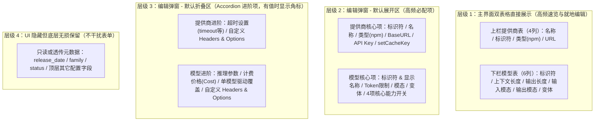
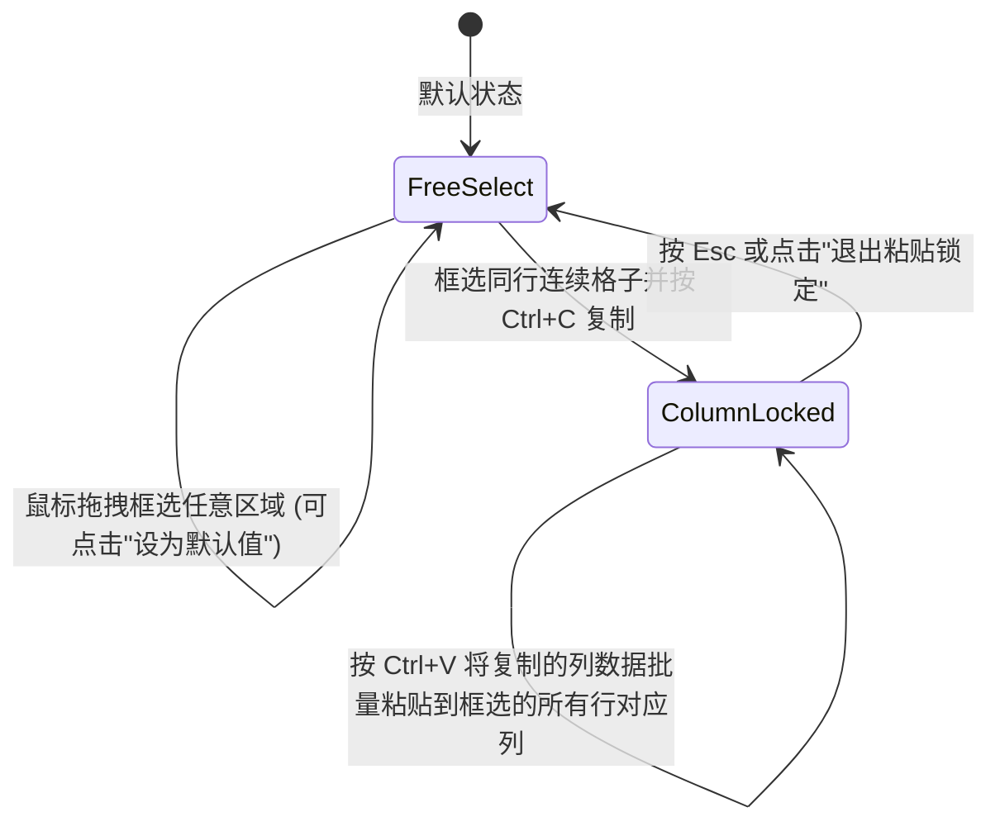

# OpenCode 配置文件编辑工具实现计划

## 1. 技术栈与跨平台原生窗口架构

针对「跨平台、不打开独立浏览器、不打包臃肿浏览器内核、完美支持复杂表格与 Material Design」的需求，采用以下架构：

- **桌面宿主与本地后端**：`Python 3.10 + pywebview`
  - **调用系统自带 WebView**：Windows 下直接调用系统内置的 Microsoft Edge WebView2，macOS 下调用系统内置 WKWebView，Linux 下调用 WebKitGTK。无需打包百兆 Chromium，也不会打开外部浏览器，运行表现为纯粹的独立桌面窗口，内存占用低且天然跨平台。
  - **零额外编译器依赖**：直接利用本机已安装的 Python 3.10 与 Node.js v24，无需下载安装 Rust 或 C++ 编译工具链。
- **前端 UI 与交互层**：`React 18 + TypeScript + Vite + Material UI (@mui/material v6)`
  - 编码前将在项目内创建并启用专属的 Material Design 3 表格与桌面配置器 Agent Skill（`.cursor/skills/material-table-configurator/SKILL.md`），统一规范紧凑型数据表格、Elevation 层级、Chip/Checkbox 密度与弹窗布局。

---

## 2. 目录与核心文件规划

- `[app.py](D:/Dev/oc-modal-configurator/app.py)`：桌面程序入口，创建 `pywebview` 原生窗口，恢复并监听窗口尺寸变化，挂载 Python API Bridge。
- `[backend/config_service.py](D:/Dev/oc-modal-configurator/backend/config_service.py)`：负责加载与保存 `opencode.json`（默认加载 `~/.config/opencode/opencode.json`，支持原生文件对话框切换其它配置文件；保存前自动创建 `.bak` 备份；完整保留 `plugin`、`$schema` 等非 `provider` 顶层字段）。
- `[backend/metadata_service.py](D:/Dev/oc-modal-configurator/backend/metadata_service.py)`：
  - 定义可扩展的 `MetadataSource` 抽象接口，默认内置 `ModelsDevSource`（对接 `https://models.dev/api.json`），并预留注册其它站点数据源的接口。
  - 模型库不随程序打包。仓库根目录的 `api.json` 只是开发样本，运行时不读取。用户点击更新后，把远程快照写到用户目录缓存；未下载时模型库为空，界面提示手动更新。
  - 提供商在线模型拉取：根据当前提供商配置的 `options.baseURL` 和 `options.apiKey` 请求 `${baseURL}/models`（兼容 OpenAI 格式；失败时改从已下载的模型库检索），返回可用模型列表。

## 2.1 工具自身的数据

不使用 SQLite。设置是一份很小的文档；模型库是上游 JSON，整份加载、整份替换。

- 正在编辑的 `opencode.json` 不是本工具的配置。它留在用户选择的路径，保存前在同目录写 `.bak`。`plugin`、`$schema` 等非 `provider` 字段原样保留。
- 本工具只有一个配置文件：`~/.config/oc-modal-configurator/settings.json`。里面只放窗口尺寸与位置、上下分栏比例、列宽、当前页，以及最近打开的配置路径。
- 模型库缓存不是配置：`~/.config/oc-modal-configurator/cache/api.json`。旁边的 `cache/api.meta.json` 只记录下载时间、来源地址和字节数，避免为了显示日期去解析整份模型库。

- `[frontend/src/App.tsx](D:/Dev/oc-modal-configurator/frontend/src/App.tsx)`：顶部分页导航栏（当前包含第一页「提供商与模型」，预留后续功能页扩展）、全局状态栏（配置文件切换、模型库更新日期与手动更新按钮、未保存标记与「保存」按钮）以及上下可调分栏容器（默认 40% / 60% 高度）。
- `[frontend/src/hooks/useSpreadsheetSelection.ts](D:/Dev/oc-modal-configurator/frontend/src/hooks/useSpreadsheetSelection.ts)`：封装类 Excel 单元格二维框选、同行连续格子复制、复制后**锁定对应列范围框选**、批量粘贴覆盖及快捷键（`Ctrl+C`、`Ctrl+V`、`Esc`）逻辑。
- `[frontend/src/components/ProviderTable.tsx](D:/Dev/oc-modal-configurator/frontend/src/components/ProviderTable.tsx)`：上栏提供商表格组件。
- `[frontend/src/components/ModelTable.tsx](D:/Dev/oc-modal-configurator/frontend/src/components/ModelTable.tsx)`：下栏模型表格组件（含前缀分组排序、并排复选框单元格、框选设为默认值）。
- `[frontend/src/components/EditDialog.tsx](D:/Dev/oc-modal-configurator/frontend/src/components/EditDialog.tsx)`：支持单条详细编辑与多条批量编辑（含 `<...>` 混合值占位符、每个字段的默认值提示与一键填入默认值功能）。
- `[frontend/src/components/AddModelsDialog.tsx](D:/Dev/oc-modal-configurator/frontend/src/components/AddModelsDialog.tsx)`：拉取并添加模型弹窗（按模型第一段名称分组、支持整组勾选或展开单选）。

---

## 3. 核心交互与业务逻辑设计

### 3.1 配置项分级分层设计与编辑控件规范（针对 NewAPI 等中转/兼容服务精简）

为了避免配置项过多导致界面拥挤，剔除不使用的云厂商专属项（如 Amazon Bedrock、Copilot）及黑白名单过滤控制，将所有配置项按使用频率划分为 **4 个展示层级**，并为每一项明确指定 Material Design (`@mui/material`) 交互控件：

---

#### 层级 1：主页面双表格直接展示（仅保留核心列）

- **上栏：提供商表格（固定 4 列）**
  - **行首区**：MUI `Checkbox`（多行选择） + 行号/详情触发按钮（双击行头打开提供商编辑弹窗）。
  - `提供商名称` (`name`)：文本展示；双击单元格切换为紧凑型 MUI `TextField` 就地编辑。
  - `提供商标识符` (`<provider_key>`)：等宽字体展示；双击单元格切换为 `TextField`（修改时自动重命名 `provider` 字典键并校验唯一性）。
  - `提供商类型` (`npm`)：显示包名；双击单元格切换为 MUI `Autocomplete`（`freeSolo` 模式，下拉提供 `@ai-sdk/openai`、`@ai-sdk/openai-compatible`、`@ai-sdk/anthropic`、`@ai-sdk/google` 等常用项，也允许自由输入）。
  - `提供商 URL` (`options.baseURL`)：单行省略号截断（`text-overflow: ellipsis`）+ 外层包裹 MUI `Tooltip` 悬浮显示完整 URL；双击单元格切换为 `TextField`。
- **下栏：模型表格（固定 6 列，默认按模型标识符第一段名称排序）**
  - **行首区**：MUI `Checkbox`（多行选择） + 行号/详情触发按钮（双击行头打开模型编辑弹窗）。
  - `模型标识符` (`<model_key>`)：等宽字体展示，左侧带第一段名称分组色标/标签；双击切换为 `TextField`。
  - `上下文长度` (`limit.context`)：右对齐数字展示（紧凑列宽）；双击切换为 `TextField (type="number")`。
  - `输出长度` (`limit.output`)：右对齐数字展示（紧凑列宽）；双击切换为 `TextField (type="number")`。
  - `输入支持的模态` (`modalities.input`)：单元格内并排 5 个紧凑 MUI `Checkbox` + 微型标签（`text`, `image`, `audio`, `video`, `pdf`），支持直接点击勾选，也支持框选粘贴与框选设为默认值。
  - `输出支持的模态` (`modalities.output`)：单元格内并排紧凑 MUI `Checkbox`（`text`, `image`, `audio`, `video`, `pdf`），交互同上。
  - `变体` (`variants`)：单元格内并排紧凑 MUI `Checkbox`（`none`, `minimal`, `low`, `medium`, `high`, `xhigh`, `max`），勾选后自动维护对应的 `variants.<key>` 对象。

---

#### 层级 2：详细编辑 / 批量编辑弹窗 —— 默认展开区（高频必配项）

打开弹窗时直接呈现，无需二次点击展开。在**批量编辑**模式下，若多行数据某字段值不一致，控件均支持 `<...>` 混合状态展示（未改动则保持各行原值，修改则统一覆盖）。

- **提供商弹窗 - 默认展开区（共 6 项）**
  - `提供商标识符` (`<provider_key>`)：MUI `TextField`（单条编辑可改；批量编辑时禁用并显示“已选 N 个提供商”）。
  - `提供商名称` (`name`)：MUI `TextField`（批量不一致时 `placeholder="<...>"`）。
  - `提供商类型` (`npm`)：MUI `Autocomplete (freeSolo)`，带常用 AI SDK 包名下拉列表及用途说明（提示 `/v1/responses` 选 `@ai-sdk/openai`，`/v1/chat/completions` 选 `@ai-sdk/openai-compatible`）。
  - `API 基础地址` (`options.baseURL`)：MUI `TextField`。
  - `API 密钥` (`options.apiKey`)：MUI `TextField`，右侧 `InputAdornment` 集成「眼睛图标（密码掩码显隐切换）」与「快捷插入变量菜单（一键填入 `{env:VAR_NAME}` 或 `{file:~/.secrets/key}`）」。
  - `启用缓存键` (`options.setCacheKey`)：MUI `Switch`（单条编辑为开关；批量编辑不一致时使用三态 `Checkbox (indeterminate)` 配合 `<...>` 标签）。
- **模型弹窗 - 默认展开区（共 6 组，每项右侧均带 `默认: xxx` 可点击胶囊 `Chip`）**
  - `模型标识符` (`<model_key>`) 与 `显示名称` (`name`)：双列并排 MUI `TextField`（标识符在批量编辑时只读）。
  - `Token 限制` (`limit.context` / `limit.output`)：双列并排 `TextField (type="number")`，右侧附带常用快捷按钮（如 `128K`, `200K`, `1M`）与默认值胶囊。
  - `输入支持的模态` (`modalities.input`)：水平排列的 MUI `Checkbox` 组（在批量编辑中，若某一项在部分行勾选、部分行未勾选，该复选框显示 `indeterminate` 半选 `<...>` 状态，不点击则保留各行原状）。
  - `输出支持的模态` (`modalities.output`)：水平排列的 MUI `Checkbox` 组（同上支持半选 `<...>` 状态）。
  - `变体档位` (`variants`)：水平排列的 MUI `Checkbox` 组（`none`, `minimal`, `low`, `medium`, `high`, `xhigh`, `max`），旁侧带「使用默认变体」胶囊。
  - `核心能力开关`（4 项并排紧凑网格）：
    - `支持附件 (attachment)`、`工具调用 (tool_call)`、`推理模型 (reasoning)`、`支持温度调节 (temperature)`
    - **控件**：单条编辑使用紧凑型 `Switch` 或 `Checkbox`；批量编辑统一使用支持三态（勾选 / 未勾选 / `<...>` 半选保持不变）的 MUI `Checkbox` + 默认值胶囊。

---

#### 层级 3：详细编辑 / 批量编辑弹窗 —— 默认折叠区（MUI `Accordion` 进阶项）

平时收起在弹窗下半部分，保持弹窗清爽；**如果当前模型/提供商已在配置文件中设置了某折叠区内的字段，该折叠面板标题右侧会自动显示蓝色 `Chip` 角标（如 `已配置 2 项`）**。

- **提供商弹窗 - 折叠区（共 2 个折叠面板）**
  1. **「超时策略 (`timeout` / `headerTimeout` / `chunkTimeout`)」**
     - 每个超时项采用「MUI `Switch`（启用超时 vs `false` 禁用）+ `TextField (type="number")`（毫秒数，带 `ms` 后缀）」组合控件。
  2. **「自定义请求头 (`options.headers`) 与扩展参数 (`options`)」**
     - `options.headers`：动态键值对列表组件（每行两个 `TextField`：`Header Name` 与 `Header Value` + 删除图标按钮，底部带「+ 添加请求头」按钮）。
     - `其它自定义 options`：轻量 JSON 文本框（用于兜底编辑非标准字段）。
- **模型弹窗 - 折叠区（共 3 个折叠面板）**
  1. **「推理参数与思考配置 (`options` & `interleaved`)」**
     - `默认推理强度 (options.reasoningEffort)`：MUI `Select` 下拉框（`未设置 / <...> / none / minimal / low / medium / high / xhigh / max`）。
     - `输出详略度 (options.textVerbosity)`：MUI `Select` 下拉框（`未设置 / <...> / low / medium / high`）。
     - `流式交错思考字段 (interleaved)`：MUI `Select` 下拉框（`未设置 / false / true / reasoning_content / reasoning / reasoning_text`）。
     - `思考预算 (options.thinking.budgetTokens)`：MUI `TextField (type="number")`。
  2. **「最大输入限制与计费价格 (`limit.input` & `cost`)」**
     - `最大输入限制 (limit.input)`：MUI `TextField (type="number")`。
     - `计费价格 (cost.input / output / cache_read / cache_write)`：4 列紧凑并排 `TextField (type="number")`，带 `$/1M tokens` 单位前缀与 `api.json` 默认价格一键填入胶囊。
  3. **「单模型驱动覆盖、请求头 (`headers`) 与高级 JSON」**
     - `单模型驱动包覆盖 (provider.npm)`：MUI `Autocomplete (freeSolo)`（当同一 NewAPI 提供商下混用 `/v1/responses` 与 `/v1/chat/completions` 模型时可单独覆盖）。
     - `单模型端点覆盖 (provider.api)` 与 `底层映射 ID (id)`：MUI `TextField`。
     - `模型专属请求头 (headers)`：动态键值对列表组件。
     - `自定义 options / 变体高级参数 JSON`：带语法校验的多行代码框。

---

#### 层级 4：隐藏 / 自动维护项（不在表单中罗列，底层无损透传）

- 以下字段不在表单中设输入框，避免视觉干扰：
  - `family`（模型家族）、`release_date`（发布日期）、`last_updated`、`knowledge`、`open_weights`、`canonical_model_id`：若 `api.json` 中存在，仅在模型编辑弹窗标题下方以一行浅灰色只读副标题徽章（如 `家族: deepseek-flash | 发布: 2026-10-17`）展示。
  - 配置文件中已有的任何其它顶层或未知字段（如 `plugin`、`$schema`、`model`、`agent`、`mcp` 等）：在读取与保存 `opencode.json` 时通过对象深合并**原样无损保留**，绝不丢失。

### 3.2 双击就地编辑 vs 双击打开详情弹窗的区分设计

- **双击数据单元格（Cell）**：直接在当前格子内激活就地编辑框（文本/数字输入框或下拉框，`Enter` 或失焦确认，`Esc` 取消；对于模态和变体等复选框列，支持直接点击打勾框切换，也支持单元格框选批量操作）。
- **双击行头号/行尾详情区打开弹窗**：每行最左侧复选框右侧设有紧凑的「行号与详情手柄列（Row Header）」，行尾设有详情图标区。**双击该行头区域（或点击详情按钮）**即弹出该条记录的「详细编辑弹窗」，既符合 Excel 双击行头的操作直觉，又与双击数据格子就地编辑完全互不干扰。

### 3.3 多行勾选、批量编辑 `<...>` 与清空选择策略

- **多行选择与批量编辑**：勾选每行左侧复选框后，点击该栏工具栏的「批量编辑」按钮打开弹窗。
- **混合值 `<...>` 逻辑**：
  - 打开批量编辑弹窗时，逐字段比对所有勾选行的数据：若所有行该字段值一致，则展示该值；若不一致，输入框/选择框显示 `<...>` 占位状态（复选框组亦支持维持 `<...>` 不覆盖状态或切换为统一修改状态）。
  - 用户未改动 `<...>` 的字段，在确定时各行保持原值不变；用户一旦修改了某字段，则将新值统一写入所有勾选行。
- **何时清空行勾选**：
  - 上栏切换了当前选中的「提供商」时，自动清空下栏模型表的行勾选。
  - 删除所选行后，自动移除已删行的勾选。
  - 工具栏提供「清空选择」按钮（或按 `Esc`），而在批量编辑完成后**保留当前勾选**，方便核对修改结果或继续执行后续批量操作。

### 3.4 类 Excel 框选与列锁定复制粘贴

- **同行连续框选复制**：当用户在某一行内框选连续的 1 个或多个格子并按下 `Ctrl+C`（或点击复制按钮），系统记录这些格子的值及它们所属的列区间 `[colStart, colEnd]`，并在表头对应列上方显示醒目的「可粘贴目标列」标记。
- **锁定列框选与批量粘贴**：复制生效后，用户在表格内再次拖拽框选时，横向列范围将自动锁定为 `[colStart, colEnd]`，纵向可自由跨越多行；按下 `Ctrl+V` 即可将复制的单行多列数据一次性批量覆盖到所选全部行的对应列中。按 `Esc` 键即可清除剪贴板锁定状态，恢复自由框选。

### 3.5 模型默认值匹配与一键设为默认

- **智能匹配算法**：针对模型标识符（如 `deepseek-v4-flash` 或 `gpt-6-astra`），从本地缓存的 `api.json` 中检索匹配模型（优先匹配当前提供商 ID，其次优先匹配 `canonical_model_id` 对应的官方提供商如 `openai`/`deepseek`/`anthropic`/`google` 或信息最完整的记录），提取默认 `limit.context`、`limit.output`、`modalities.input`、`modalities.output` 以及由 `reasoning_options` 转换出的默认 `variants`。
- **弹窗内默认值提示与一键应用**：在单条编辑和批量编辑弹窗中，每个字段旁均显示默认值提示胶囊（如 `默认: 1048576`、`默认: text, image`），点击该提示胶囊即可将该默认值填入当前输入框或打勾框（在批量编辑中点击默认值胶囊，也会解除 `<...>` 并将默认值应用到所有选中行）。
- **表格框选设为默认**：在模型表格中框选任意单元格区域后，点击工具栏「设为默认值」按钮，自动把框选格子涉及的字段重置为各自模型在 `api.json` 中的默认值。

### 3.6 分组拉取与添加模型弹窗

- 点击下栏工具栏「添加模型」按钮打开弹窗：
  - 支持从当前提供商的 `baseURL` 实时请求 `/models` 接口拉取可用模型列表（若提供商接口未配置或不可达，可一键切换/合并从本地 `api.json` 模型库中按提供商或全量检索）。
  - 拉取到的所有模型自动按**第一段名称**（如 `deepseek`、`gpt`、`gemini`、`kimi`、`claude`）归类分组并按字母排序。
  - 每个分组渲染为可折叠面板：勾选分组头部的复选框即可**整组批量选择**，点击展开分组后也可**单独勾选某个具体模型**；确认添加后自动带入 `api.json` 中的默认上下文长度、模态和变体配置。

### 3.7 手动保存机制

- 所有表格就地修改、弹窗编辑、粘贴、设为默认、增删行等操作均修改前端工作区状态，顶部导航栏实时显示「未保存修改」状态提示，只有点击顶部「保存」按钮（或按 `Ctrl+S`）时才调用后端写入 `opencode.json` 文件。