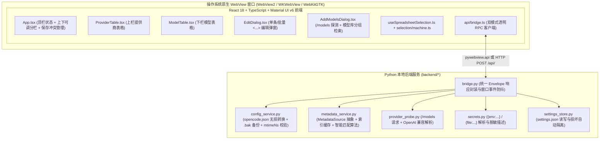
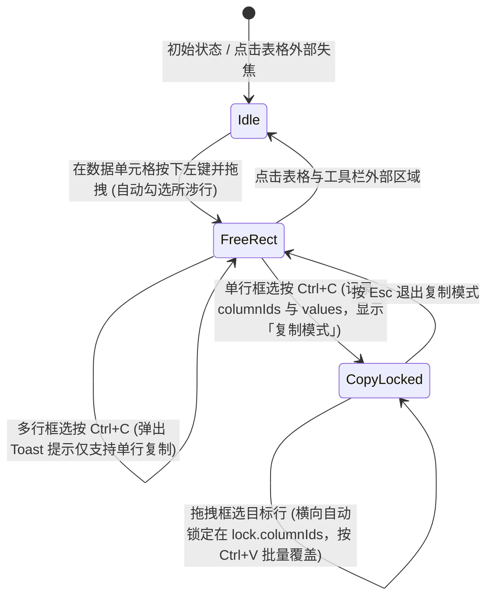

# OpenCode 配置编辑器 —— 系统架构与技术设计文档

## 1. 架构概览

本项目采用 **本地 Python 宿主 (`pywebview`) + React 单页应用 (SPA)** 的双层桌面架构。在正式桌面模式下，前端与后端处于同一进程内，通过 `window.pywebview.api` 进行异步方法调用；在开发模式下，后端额外暴露轻量级本地 HTTP RPC 服务 (`127.0.0.1:8765`)，由 Vite 开发服务器代理 `/api/*`，从而实现一套代码同时支持原生窗口运行与浏览器热重载调试。



---

## 2. 数据存储与文件边界设计

### 2.1 为什么不使用 SQLite？

在架构设计阶段，我们评估了 SQLite 与独立配置文件方案，最终选择**纯 JSON 文件存储**，原因如下：

1. **工具配置极小且整体读写**：工具自身的持久化状态仅有窗口坐标/尺寸、分栏比例、两张表的列宽以及最近打开的路径列表（不足 1 KB），每次仅在拖拽结束 (`pointerup`) 或窗口关闭时更新，单一 `settings.json` 原子写入既简单又方便用户直接查看或删除重置。
2. **上游模型库是快照式文档**：`models.dev/api.json` 是上游发布的完整 JSON 快照（约 5–6 MB），更新时整份替换、启动后在内存中建立哈希索引（耗时 < 100ms），无需关系型数据库的增删改查或表结构迁移，而且文件缓存天然支持用户在离线环境下直接拷贝替换 `api.json`。

### 2.2 三类文件的严格隔离

| 数据类别 | 默认路径 | 职责与生命周期 |
| :--- | :--- | :--- |
| **目标配置文件** (`opencode.json`) | `~/.config/opencode/opencode.json`（或 `--config` 指定路径；开发模式隔离为 `.dev/opencode.json`） | 用户正在编辑的业务文件。保存前在同一目录生成 `opencode.json.bak`；绝不混入任何编辑器 UI 状态。 |
| **工具自身设置** (`settings.json`) | `~/.config/oc-modal-configurator/settings.json`（开发模式为 `.dev/appdata/settings.json`） | 工具唯一的自身配置文件。记录 `window`、`splitRatio`、`activePage`、`providerColumns`、`modelColumns`、`lastConfigPath`、`recentConfigPaths`。若文件损坏会自动重命名为 `settings.json.bad` 并回退默认值。 |
| **模型库快照缓存** (`cache/api.json` & `cache/api.meta.json`) | `~/.config/oc-modal-configurator/cache/api.json` | 按需下载的 `models.dev` 模型库快照。旁侧的 `api.meta.json` 仅记录 `updatedAt`、`sourceUrl` 和 `bytes`，使顶栏读取更新时间时无需解析数兆的 `api.json`。仓库根目录下的 `api.json` 仅作开发对照样本，运行时不读取、打包时不收录。 |

---

## 3. 后端核心模块设计 (`backend/`)

### 3.1 无损配置转换引擎 (`backend/config_service.py`)

为了实现「表单易用性」与「底层 JSON 无损保留」的统一，`config_service.py` 在加载和保存时执行双向规范化转换：

- **加载 (`document_from_raw`)**：
  1. 提取顶层除 `provider` 以外的所有键值存入 `document.preserved`；
  2. 将 `provider` 字典转换为有序列表 `providers: list[ProviderEntry]`，每个条目将已知配置项（`name`、`npm`、`options.baseURL` 等）提取为结构化字段，其余未知属性分别存入 `provider.extra` 和 `provider.optionsExtra`；
  3. 将每个提供商下的 `models` 字典转换为有序列表 `models: list[ModelEntry]`，未知属性分别存入 `model.extra`、`limit.extra`、`cost.extra`、`model.provider.extra`；
  4. 将 `interleaved` 字段规范化：文件中的 `{"field": "reasoning_content"}` 在前端领域模型中统一表示为字符串 `"reasoning_content"`，布尔值保持 `True`/`False`。
  5. 记录当前文件纳秒级修改时间 `mtimeNs`（以字符串传输，避免 JavaScript `Number` 53 位精度丢失）。
- **保存 (`to_raw`)**：
  1. 校验 `document.preserved` 存在，校验所有提供商 `key` 与同一提供商下模型 `key` 的非空与唯一性；
  2. 比对磁盘文件的 `st_mtime_ns` 与传入的 `document.mtimeNs`（若不一致且 `force=False`，抛出 `ServiceError("conflict", ...)`）；
  3. 将各级 `extra` / `optionsExtra` 作为基底字典，再将结构化字段写回（**结构化字段优先级高于高级 JSON 文本框**；值为 `None` 或空字符串的字段自动省略，避免污染配置文件）；
  4. 若原文件存在，先拷贝生成 `.bak`，再通过 `jsonio.write_json` 写入 `.tmp` 并原子替换目标文件，最后返回新的 `mtimeNs`。

### 3.2 可扩展模型库与默认值匹配算法 (`backend/metadata_service.py`)

#### 多数据源抽象 (`MetadataSource`)

定义了抽象基类 `MetadataSource`（包含 `load`、`refresh`、`clear`、`describe` 接口）。`MetadataService` 内部维护 `sources: list[MetadataSource]`，默认注册 `ModelsDevSource`，并在 `get_metadata_status()` 中返回 `sources` 列表与 `activeSourceId`，支持通过 `register()` 接入其它模型元数据站点。

#### 内存多维索引 (`CatalogIndex`)

首次查询或刷新后，`MetadataService._ensure_index()` 遍历缓存字典，构建三级内存索引：
- `by_exact: dict[tuple[provider_id, model_id], CatalogEntry]`
- `by_model: dict[model_id, list[CatalogEntry]]`
- `by_model_fold: dict[model_id_lower, list[CatalogEntry]]`（大小写不敏感索引）

#### 四级智能匹配优先级 (`MetadataService.match`)

当用户为某模型（如中转提供商 `mammotion-openai` 下的 `gpt-6-astra` 或别名 `deepseek-flash`）请求默认参数时，按以下优先级检索信息最完整的记录：

1. **提供商精确匹配 (`matchKind = "provider"`)**：若 `provider_hint` 在模型库中存在同名 `(provider_hint, model_key)` 记录且包含有效参数（`_useful`），直接采用。
2. **官方提供商同名模型 (`matchKind = "exact"`)**：在所有同名 `model_key` 记录中，优先筛选官方提供商集合 `OFFICIAL_PROVIDER_IDS = {"openai", "deepseek", "anthropic", "google"}` 中有效且完整度得分（`_completeness`）最高的一条。
3. **Canonical 权威模型追踪 (`matchKind = "canonical"`)**：若同名记录包含 `canonical_model_id`（例如 `deepseek/deepseek-v4.1-flash-1017` 或 `openai/gpt-6-astra`），顺着 `canonical_model_id` 反查权威提供商下的目标记录并取完整度最高者。
4. **全库最高完整度回退 (`matchKind = "exact"`)**：在剩余同名记录中按完整度评分（`context` +10、`output` +8、`modalities` +12、`cost` +4、`reasoning_options` +4 等）选出最优记录。

同时，`variants_from_reasoning()` 会自动解析 `models.dev` 中的 `reasoning_options`（当 `type == "effort"` 时提取 `values`），并按标准顺序 `("none", "minimal", "low", "medium", "high", "xhigh", "max")` 转换为 OpenCode 的 `variants` 字典。

### 3.3 密钥安全解析 (`backend/secrets.py`)

OpenCode 支持三种 `apiKey` 写法：
- 字面量密钥：`sk-...`
- 环境变量引用：`{env:OPENAI_API_KEY}`
- 外部文件引用：`{file:~/.secrets/openai_key}`

`secrets.py` 提供两个严格分离的函数：
- `describe_api_key(value)`：供前端 UI 调用，仅返回 `{kind: "empty"|"env"|"file"|"literal", name: "...", resolvable: bool}`，**绝不包含密钥原文**；
- `resolve_secret(value)`：仅在后端 `probe_provider_models` 发起 `/models` 请求时在进程内调用，将引用解析为真实 Token 放入 `Authorization: Bearer ...` 请求头。

### 3.4 统一 Bridge 与异常信封 (`backend/bridge.py`)

所有暴露给前端的方法统一返回 `Envelope<T>` 结构：

```json
{
  "ok": true,
  "data": { ... }
}
```
或失败时：
```json
{
  "ok": false,
  "error": {
    "code": "conflict | validation_error | invalid_json | network_error | probe_failed | ...",
    "message": "人类可读的中文错误信息"
  }
}
```

前端 `frontend/src/api/bridge.ts` 自动检测运行环境：若 `window.pywebview?.api` 存在则直接调用原生 Bridge，否则向 `/api/<method>` 发送 `POST` 请求；遇到 `ok: false` 时统一抛出带 `code` 属性的 `BridgeError`。

---

## 4. 前端核心机制设计 (`frontend/src/`)

### 4.1 类 Excel 框选与列锁定状态机 (`selection/machine.ts` & `useSpreadsheetSelection.ts`)

表格框选逻辑被拆分为纯函数状态机 (`machine.ts`) 与 DOM 事件 Hook (`useSpreadsheetSelection.ts`)：



- **DOM 契约**：每个数据单元格 `<td>` 挂载 `data-sheet-cell="true"`、`data-row-id` 和 `data-col-id`。
- **控件穿透**：当点击事件发生在单元格内部的 `input, button, textarea, select, label`（如模态图标按钮或变体复选框）上时，自动跳过拖拽框选起始逻辑，保证直接点击开关顺畅响应。
- **工具栏保活**：每个表格组件的 `containerRef` 同时包裹其顶部工具栏与表格主体，确保框选单元格后点击工具栏上的「默认」按钮不会触发外部失焦清空。
- **单元格文本序列化**：
  - `inputModalities` / `outputModalities` 在复制粘贴时序列化为逗号分隔字符串（如 `"text,image,pdf"`）；通过图标单点切换某个已知模态时，`toggleKnownModality` 会保留该模型原有的未知自定义模态词条。
  - `variants` 在复制粘贴时序列化为逗号分隔键名（如 `"low,medium,high"`）；通过复选框或粘贴更新时，`applyVariantsFromCell` 与 `toggleVariantKey` 会保留已存在的 `variants[key]` 内部自定义子属性。

### 4.2 批量编辑 `<...>` 混合状态算法 (`ProviderEditSection.tsx` & `ModelEditSection.tsx`)

当传入的 `targets` 数组长度大于 1 时，编辑弹窗进入批量模式：

1. **初始同质性检测**：对每个表单字段计算所有选中行的值是否完全一致（使用深比较或规范化比较）。
   - 若一致：表单控件展示该共同值；
   - 若不一致：文本/数字/下拉框置为空并显示 `placeholder="<...>"`，布尔与复选框置为 `mixed` (`indeterminate`) 状态，请求头编辑器展示混合提示横幅。
2. **脏字段追踪 (`dirtyFields`)**：仅当用户主动修改了某个控件，或点击了该字段旁的 `默认: xxx` 胶囊时，才将该字段标记为已修改（解除 `<...>` 状态）。
3. **确认合并**：点击「确认」时，遍历所有选中行；对于未触碰的 `<...>` 字段，保留每行各自原有的值；对于已修改的字段，将新值统一写入所有选中行。

---

## 5. 跨机器可执行文件打包设计 (`packaging/`)

为了生成的 Windows 可执行文件能够直接拷贝到未安装 Python、Conda 或 Node.js 的其它电脑上运行，`packaging/oc-modal-configurator.spec` 与 `packaging/build_windows.ps1` 做了以下针对性处理：

1. **目录式分发 (`onedir` + `.zip`)**：采用 PyInstaller `COLLECT` 目录模式而非单文件自解压模式，避免每次启动解压数十兆临时文件导致窗口弹出缓慢，也避免杀毒软件误报。
2. **收集 WebView2 互操作库**：自动通过 `collect_all` 打包 `webview`、`pythonnet` 和 `clr_loader` 所需的 `.dll`（包括 `WebView2Loader.dll`、`Microsoft.Web.WebView2.Core.dll`、`Microsoft.Web.WebView2.WinForms.dll` 及 `ClrLoader.dll`）。
3. **补齐 Conda 环境下的 OpenSSL 动态库**：当宿主 Python 来自 Conda 环境时，`libssl-3-x64.dll`、`libcrypto-3-x64.dll`、`ffi.dll` 等位于 `Library/bin` 下。`.spec` 脚本会自动解析 `pyvenv.cfg` 并把这些动态库一并打入 `_internal/`，确保目标电脑在无 Conda 环境下依然能正常发起 HTTPS 请求（拉取 `/models` 或下载 `models.dev`）。
4. **剔除开发样本 `api.json`**：构建脚本在打包完成后会自动扫描输出目录，确保仓库根目录的开发样本 `api.json` 未被误打包。
5. **目标机器运行环境自检 (`ensure_windows_runtime`)**：`app.py` 在 Windows 下启动前会检查注册表中的 `.NET Framework 4.6.2+` 与 `Edge WebView2 Runtime`，若目标机器缺失系统组件，通过原生 `MessageBoxW` 弹出清晰的中文安装指引与官方下载链接。
